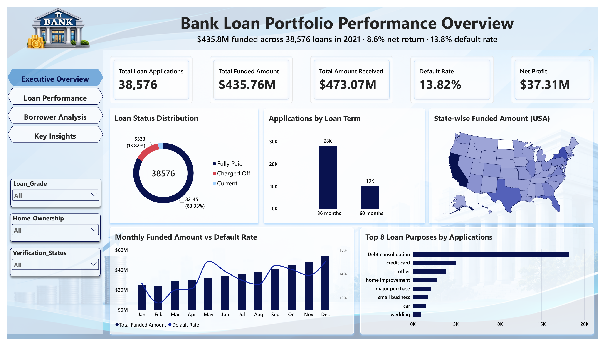
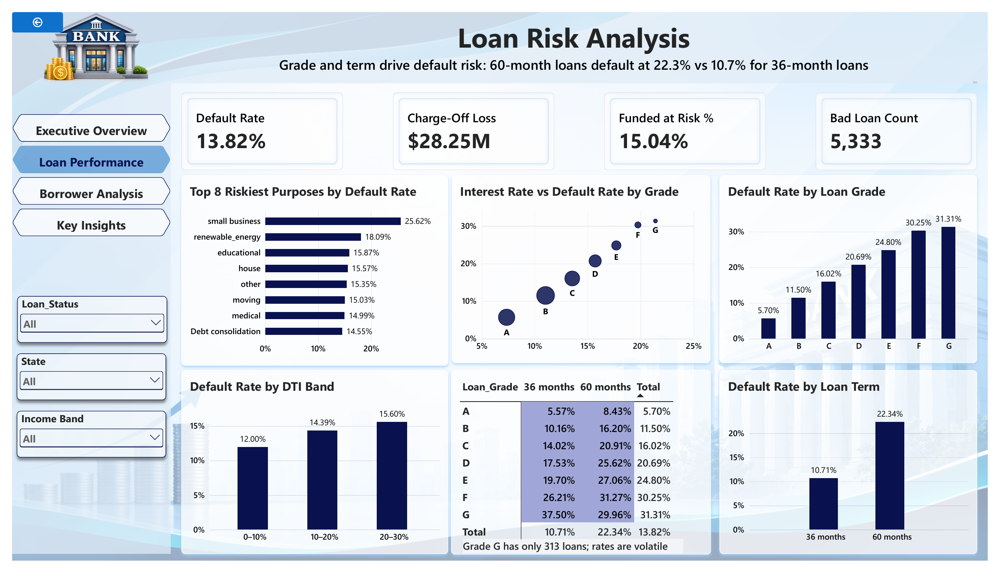
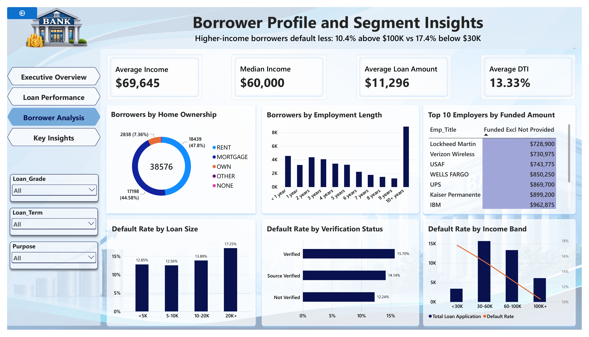
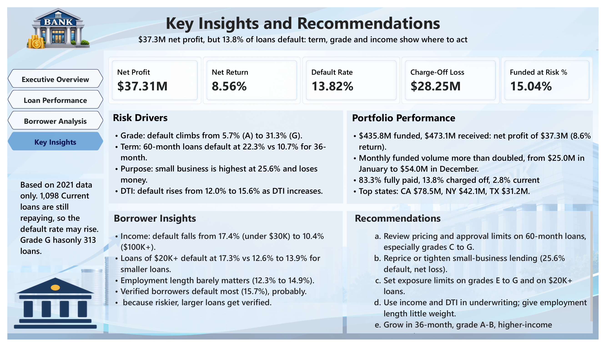

# 🏦 Bank Loan Portfolio & Credit Risk Analysis

The project validates and prepares the data in Python, answers business questions in SQL, and delivers a 4-page Power BI dashboard...

End-to-end analysis of a 2021 bank loan portfolio (38,576 loans, $435.8M funded) using **Python, MySQL, Excel and Power BI**. The project cleans the raw data, answers business questions in SQL, and delivers a 4-page Power BI dashboard that shows which loan and borrower segments drive defaults.

## 📊 Dashboard Preview

**Executive Overview**


**Loan Risk Analysis**


**Borrower Profile and Segment Insights**


**Key Insights and Recommendations**


## 🔑 Key Findings

### Portfolio performance
| Metric | Value |
|---|---|
| Loan applications | 38,576 |
| Total funded amount | $435.76M |
| Total amount received | $473.07M |
| Net profit | $37.31M (8.56% net return) |
| Default rate | 13.82% (5,333 charged-off loans) |
| Charge-off loss | $28.25M |
| Funded amount at risk | 15.04% |

- **Loan status:** 83.33% fully paid, 13.82% charged off, 2.85% current (1,098 loans still repaying).
- **Growth:** monthly funded volume more than doubled, from $25.0M in January to $54.0M in December.
- **Top states by funded amount:** CA $78.5M, NY $42.1M, TX $31.2M.
- **Top purpose by volume:** debt consolidation.

### Risk drivers
- **Grade:** default rate climbs steadily from **5.70% (A)** to **31.31% (G)**.
- **Term:** 60-month loans default at **22.34%** vs **10.71%** for 36-month loans.
- **Grade × term:** the gap holds in every grade except G. For example, grade C defaults at 14.02% (36m) vs 20.91% (60m).
- **Purpose:** small business is the riskiest at **25.62%**, followed by renewable energy (18.09%) and educational (15.87%).
- **Default Rate:** Default rate is 13.82% of all loans (14.23% of closed loans, excluding the 1,098 still repaying).

### Borrower insights
- **Income:** default falls from **17.4%** (under $30K) to **10.4%** ($100K+). Average income is $69,645, median $60,000.
- **Loan size:** loans of $20K+ default at **17.25%** vs 12.56% to 13.89% for smaller loans. Average loan is $11,296.
- **Employment length:** barely matters (12.3% to 14.9%).
- **Verification:** verified borrowers default *most* (15.70%) vs 12.24% for not verified. This is likely selection bias, since riskier and larger loans are more often verified.
- **Home ownership:** 47.8% rent, 44.58% mortgage, 7.36% own.

## 💡 Recommendations

1. Review pricing and approval limits on **60-month loans**, especially grades C to G.
2. Reprice or tighten **small-business lending** (25.6% default, net loss).
3. Set exposure limits on **grades E to G** and on **$20K+ loans**.
4. Use **income and DTI** in underwriting; give employment length little weight.
5. Grow in **36-month, grade A-B, higher-income** segments.

## ⚠️ Limitations

- Based on **2021 data only**. The 1,098 current loans are still repaying, so the default rate may rise.
- **Grade G has only 313 loans**, so its rates are volatile (it is the one grade where 36-month loans default more than 60-month).
- DTI analysis covers the 0-30% range only.
- Associations, not causal effects: no model was built to control for confounders.

## 🛠️ Tech Stack

| Stage | Tool |
|---|---|
| Cleaning and EDA | Python (Pandas, NumPy, Matplotlib, Seaborn) |
| Business queries | MySQL |
| Supporting analysis | Excel |
| Dashboard | Power BI (DAX measures, 4 report pages, slicers) |

## 📂 Project Structure

```
├── Python/    # data cleaning + EDA
├── SQL/       # business and risk queries
├── PowerBI/   # .pbix dashboard + screenshots
├── Excel/     # supporting workbook
└── README.md
```

## 🧹 Data Cleaning & EDA (Python)

- Loaded 38,576 rows × 24 columns and checked for missing values, duplicate rows and duplicate `Loan_ID`s. There were no duplicates.
- Only `Emp_Title` had missing values (5 rows), filled with `"Unknown"`.
- Stripped extra whitespace from all text columns.
- Converted currency columns (`Annual_Income`, `Loan_Amount`, `Total_Amount_Paid`) from text like `$30,000.00` to numeric.
- Converted the four date columns to datetime and standardized them to `YYYY-MM-DD`.
- Created `Loan_Category`: Good (Fully Paid), Bad (Charged Off), Current.
- Computed portfolio KPIs and explored loans by grade, state, purpose and loan amount with Pandas, NumPy, Matplotlib and Seaborn.
- Exported the result to `Bank_Loan_Python_Cleaned.csv`.

## 🗄️ SQL Analysis

All queries are in [`SQL/Bank_Loan_Portfolio_Analysis.sql`](SQL/Bank_Loan_Portfolio_Analysis.sql), organized in 25 sections:

| Area | Sections |
|---|---|
| Data validation (duplicates, nulls, date range) | 1, 25 |
| Portfolio KPIs, median loan amount | 2 |
| Good vs bad loans, loan status | 3-5 |
| Segments: term, purpose, home ownership, verification | 6-9 |
| Grade and sub-grade risk | 10 |
| State and monthly trends, month-over-month growth (window functions) | 11, 12, 21 |
| Borrower: income, DTI, employment, interest rate | 13-17 |
| Rankings, share-of-total, grade × home-ownership risk | 18-23 |


## 📁 Dataset

- **Size:** 38,576 loans × 24 columns, all issued in 2021.
- **Source:** [Advanced Bank Loan Data Analysis](https://www.kaggle.com/datasets/tusharnandanwar0805/advanced-bank-loan-data-analysis) on Kaggle, by tusharnandanwar0805.

| Group | Columns |
|---|---|
| Identifiers | `Loan_ID`, `Member_ID` |
| Loan details | `Loan_Amount`, `Loan_Term`, `Interest_Rate`, `Monthly_Installment`, `Purpose`, `Loan_Grade`, `Loan_Sub_Grade`, `Loan_Status`, `Total_Amount_Paid` |
| Borrower | `Annual_Income`, `Debt_To_Income_Ratio`, `Emp_Title`, `Emp_Length`, `Home_Ownership`, `Verification_Status`, `Total_Accounts`, `State`, `Application_Type` |
| Dates | `Issue_Date`, `Last_Credit_Pull_Date`, `Last_Payment_Date`, `Next_Payment_Date` |

## ▶️ How to Run

```bash
pip install pandas numpy matplotlib seaborn
```
1. Run the notebook in `Python/` to produce the cleaned CSV.
2. Import the cleaned CSV into MySQL and run the scripts in `SQL/`.
3. Open the `.pbix` in `PowerBI/` and update the data source path.

## 👩‍💻 Author

Srushti Chavan | Data Analyst Portfolio Project
